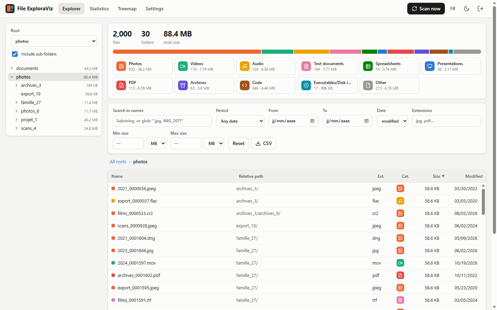
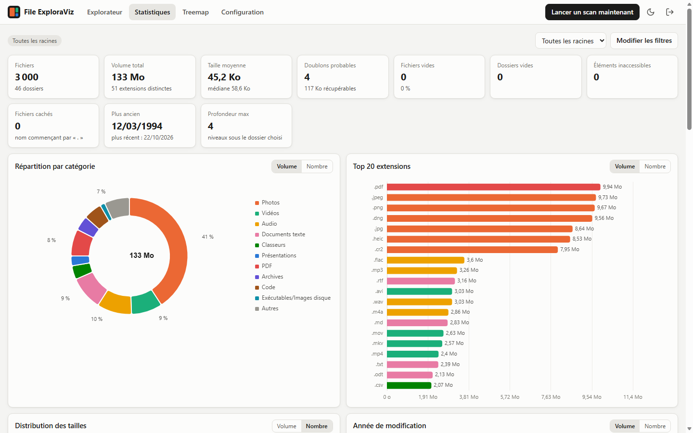
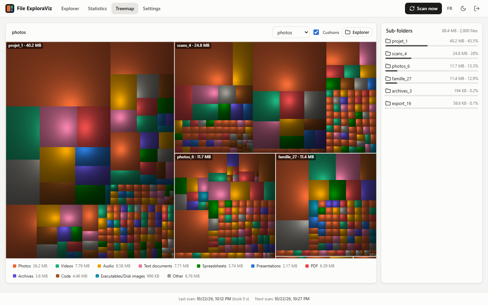
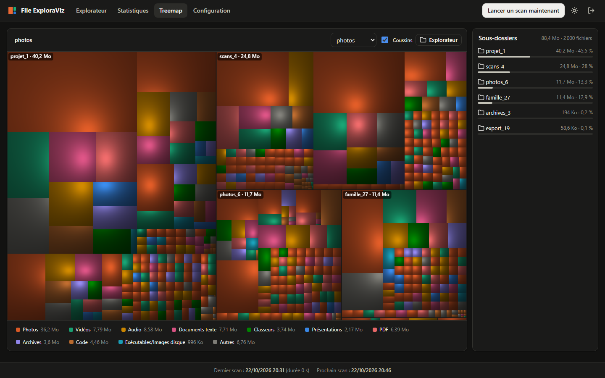
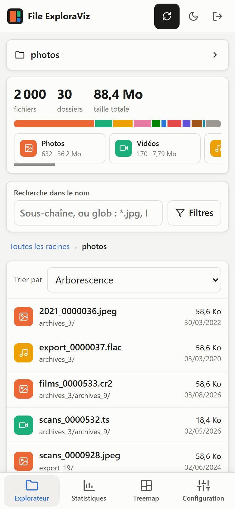
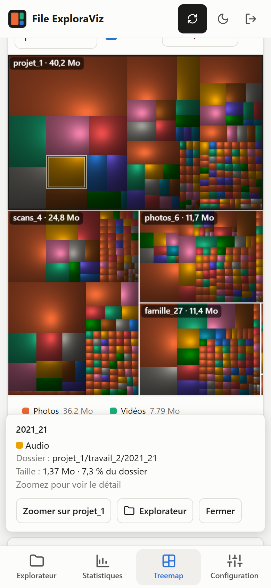

# File ExploraViz

A self-hosted web application that **periodically scans your directories in read-only mode**,
stores the results in **YAML** files and presents them as a filterable file explorer, statistics
and a **WinDirStat-style treemap**. It is built for a NAS: the scan runs at low priority
(`nice 19`, *idle* I/O class) and browsing never touches the disk again.

* **Ready-made image** on GitHub (`ghcr.io/bichoumac/file-exploraviz`, amd64 + arm64): deploy on
  **TrueNAS SCALE + Dockge** or **standalone Docker** with one compose file, nothing to build.
* Mandatory login (bcrypt, signed `HttpOnly`/`SameSite=Strict` cookie, brute-force protection).
* Interface in **English or French** (one-click switch), light/dark theme, dedicated **mobile
  layout**, no Internet dependency at runtime.

| Explorer | Statistics |
|---|---|
|  |  |
| **Treemap** | **Treemap (dark theme)** |
|  |  |

| **Mobile: Explorer** | **Mobile: Treemap (block tapped)** |
|---|---|
|  |  |

*Screenshots taken on a synthetic dataset (`scripts/gen_tree.py`).*

---

## Table of contents

1. [Features](#features)
2. [Installing on TrueNAS SCALE with Dockge](#installing-on-truenas-scale-with-dockge)
   — [Updating File ExploraViz from Dockge](#updating-file-exploraviz-from-dockge)
3. [Standalone installation (Docker Compose)](#standalone-installation-docker-compose)
4. [Configuration](#configuration)
5. [Backup](#backup)
6. [Measured performance](#measured-performance)
7. [Troubleshooting](#troubleshooting)
8. [Development](#development)
9. [Known limitations](#known-limitations)
10. [Roadmap](#roadmap)
11. [Design decisions](#design-decisions)
12. [License](#license)

---

## Features

**Scanning**
* Automatic every 15 minutes (configurable; 0 = disabled), with an optional off-peak window.
* "Scan now" button (all roots or a single root) and "Cancel scan".
* Live progress (Server-Sent Events): files, folders, volume, current folder, speed, and a
  percentage estimated from the previous scan (or from remaining folders, flagged as an estimate).
* One scan at a time. Glob exclusions, maximum depth, symbolic links not followed by default (and
  never outside the roots). Permission errors are logged, counted and the scan carries on.
* **No scan on page load**: the UI reads the latest result, loaded into memory once.

**Explorer**: summary banner (files, folders, volume, clickable per-category breakdown),
collapsible folder tree, breadcrumb, combinable filters (modification or creation date with
shortcuts, extensions with autocompletion, categories, size range, substring or glob name search),
filters stored in the URL (shareable links), sortable columns, server-side pagination, virtualised
table, CSV export.

**Statistics**: donut per category (volume/count), top 20 extensions, size histogram (log buckets),
modification years, file age, top 50 files and top 20 folders, most populated folders, probable
duplicates (same name + same size) with reclaimable space, empty files and folders, inaccessible
items, hidden files, suspicious dates, evolution over time. Every statistic follows the Explorer
filters.

**Treemap**: *squarified* layout, Canvas rendering, WinDirStat-like *cushion* shading (optional),
colour per category, clickable legend to hide a category, tiny items grouped together, tooltip
(path, size, % of parent, date), click to zoom, double-click to open the folder in the Explorer,
side panel of sub-folders synchronised with the map.

**Languages**: English by default; the **FR/EN** button in the top bar switches to French. The
choice is remembered by the browser and sent to the server in a cookie, so API messages (errors,
scan progress, CSV export headers) follow it as well.

**Mobile layout** (screens 760 px wide or less): bottom tab bar; collapsible folder tree and
filters panel with an active-filter counter; files shown as cards with a sort drop-down;
horizontally scrolling categories; touch-friendly treemap (a tap opens a sheet with "Zoom" and
"Explorer" actions); 16 px inputs to avoid iOS auto-zoom; notch-aware (`safe-area`). On tablets the
columns stack.

**Accounts and folder permissions**: several accounts, each either an **administrator** (settings,
scans, accounts, every folder) or a **viewer** limited to chosen folders (sub-folders included).
Administrators create accounts and reset viewers' passwords from **Settings → Accounts**. See
[Accounts and folder permissions](#accounts-and-folder-permissions).

**Configuration**: roots detected under `/data`, scheduling, exclusions, extension → category
mapping (applied without rescanning), options, accounts, password and session lifetime, "clear
cache and rescan".

---

## Installing on TrueNAS SCALE with Dockge

Procedure for TrueNAS SCALE 24.10 ("Electric Eel") or later, which ships Docker natively, with
[Dockge](https://github.com/louislam/dockge) already installed (**Apps → Discover Apps → Dockge**).
The ready-made image is pulled from GitHub (`ghcr.io/bichoumac/file-exploraviz`, amd64 and arm64):
there is nothing to build.

The examples use the pool `tank` and the datasets `tank/photos` and `tank/documents`;
`{{ PUID - Step 1 }}` and `{{ GUID - Step 1 }}` stand for the UID and GID you write down in step 1.
**Replace them everywhere with your own values.** Commands are typed in **System → Shell**
(or over SSH) with the administrator account, hence `sudo`.

**What we are going to set up**

| Path on the NAS | Purpose | Rights of the `exploraviz` user |
|---|---|---|
| `/mnt/tank/photos`, `/mnt/tank/documents` | data to analyse | **read-only** (ACL), plus `:ro` mount |
| `/mnt/tank/apps/file-exploraviz/config` | `config.yaml` (settings, account) | read/write |
| `/mnt/tank/apps/file-exploraviz/cache` | scan results (YAML) | read/write |

### Step 1 — Create a dedicated group and user

1. **Credentials → Groups → Add**
   * **GID**: keep the suggested value and **write it down**: it is `{{ GUID - Step 1 }}`;
   * **Name**: `exploraviz`;
   * leave the rest as is, then **Save**.
2. **Credentials → Users → Add** ("Local Users" on some versions)
   * **Full Name**: `File ExploraViz`, **Username**: `exploraviz`;
   * **Disable Password**: on (this account never logs in);
   * **UID**: keep the suggested value and **write it down**: it is `{{ PUID - Step 1 }}`;
   * **Create New Primary Group**: unchecked, then **Primary Group**: `exploraviz`;
   * **Home Directory**: `/var/empty`, **Shell**: `nologin`;
   * **SMB User**: unchecked;
   * **Save**.
3. Check in the Shell:
   ```sh
   id exploraviz
   # uid={{ PUID - Step 1 }}(exploraviz) gid={{ GUID - Step 1 }}(exploraviz) groups={{ GUID - Step 1 }}(exploraviz)
   ```

### Step 2 — Grant read access on every dataset to analyse

Repeat for **each** dataset (`tank/photos`, then `tank/documents`…):
**Datasets** → click the dataset → **Permissions** card → **Edit**. The editor you get depends on
the dataset's ACL type.

**A. "Edit ACL" editor, NFSv4 type** (usual for SMB-shared datasets)

1. **Add Item**, then fill in the entry:
   * **Who**: `Group`; **Group**: `exploraviz`;
   * **ACL Type**: `Allow`;
   * **Permissions Type**: `Basic`; **Permissions**: `Read`;
   * **Flags Type**: `Basic`; **Flags**: `Inherit`.
2. Tick **Apply permissions recursively** (and confirm), and **Apply permissions to child
   datasets** if the dataset has child datasets.
3. **Save Access Control List**. Applying can take a while on a large dataset.

**B. "Edit ACL" editor, POSIX type** ("Generic" datasets)

1. **Add Item**: **Who**: `Group`, **Group**: `exploraviz`, **Permissions**: `Read` + `Execute`.
2. **Add Item** a second time with the same values and **Default** ticked, so that files created
   later inherit it.
3. Tick **Apply permissions recursively**, then **Save Access Control List**.

**C. "Unix Permissions Editor"** (no ACL on the dataset)

* Either switch to an ACL with the **Set ACL** (or **Add ACL**) button and follow case B;
* or, simpler but less strict, give **Other** the **Read** and **Execute** rights, applied
  recursively. Every local account on the NAS can then read this data.

**Check in the Shell** (for each dataset):

```sh
cd /
sudo -u exploraviz ls /mnt/tank/photos | head                    # must list the content
sudo -u exploraviz touch /mnt/tank/photos/write-test             # must answer "Permission denied"
sudo -u exploraviz find /mnt/tank/photos > /dev/null             # prints nothing if everything is readable
```

The last command lists folders that are still unreadable. Fix them by going through step 2 again,
making sure **Apply permissions recursively** is ticked.

### Step 3 — Create the application folders

(Optional but recommended: first create the dataset `tank/apps/file-exploraviz` through
**Datasets → Add Dataset**, preset **Generic**, so it can be backed up with snapshots.)

```sh
sudo mkdir -p /mnt/tank/apps/file-exploraviz/config /mnt/tank/apps/file-exploraviz/cache
sudo chown -R {{ PUID - Step 1 }}:{{ GUID - Step 1 }} /mnt/tank/apps/file-exploraviz
```

### Step 4 — Create the stack in Dockge

1. In Dockge, click **+ Compose**.
2. **Stack Name**: `file-exploraviz`.
3. Replace the whole content of the **compose.yaml** editor with the file below, then **adapt the
   two "Directories to scan" lines** to your datasets (it is the [`compose.yaml`](compose.yaml) of
   this repository):

   ```yaml
   services:
     file-exploraviz:
       image: ghcr.io/bichoumac/file-exploraviz:${FEV_TAG:-latest}
       container_name: file-exploraviz
       restart: unless-stopped
       ports:
         - "${HOST_PORT:-59125}:8080"
       environment:
         PUID: ${PUID:-1000}
         PGID: ${PGID:-1000}
         SUPPLEMENTARY_GIDS: ${SUPPLEMENTARY_GIDS:-}
         TZ: ${TZ:-Europe/Paris}
         ADMIN_USER: ${ADMIN_USER:-admin}
         ADMIN_PASSWORD: ${ADMIN_PASSWORD:-}
         SCAN_INTERVAL_MINUTES: ${SCAN_INTERVAL_MINUTES:-15}
         LOG_LEVEL: ${LOG_LEVEL:-INFO}
         AUTH_DISABLED: ${AUTH_DISABLED:-false}
         FORWARDED_ALLOW_IPS: ${FORWARDED_ALLOW_IPS:-127.0.0.1}
       volumes:
         - ${APP_DATA:-.}/config:/config
         - ${APP_DATA:-.}/cache:/cache
         # Directories to scan: one sub-folder of /data each, ALWAYS read-only (:ro)
         - /mnt/tank/photos:/data/photos:ro
         - /mnt/tank/documents:/data/documents:ro
       read_only: true
       tmpfs:
         - /tmp:size=64m,mode=1777
       security_opt:
         - no-new-privileges:true
       cap_drop:
         - ALL
       cap_add:
         - CHOWN
         - DAC_OVERRIDE
         - FOWNER
         - SETUID
         - SETGID
       # mem_limit: 768m
       # cpus: "1.0"
   ```

   * **One line per dataset**: `path-on-the-NAS:/data/<name>:ro`. `<name>` becomes the root name in
     the UI (it can be renamed later in **Settings**).
   * The UI is published on port **59125** by default. The right-hand port (`8080`, inside the
     container) stays as is: to publish another port, change `HOST_PORT`.

4. In the **.env** editor (below the compose editor in Dockge), paste:

   ```ini
   FEV_TAG=latest
   APP_DATA=/mnt/tank/apps/file-exploraviz
   PUID={{ PUID - Step 1 }}
   PGID={{ GUID - Step 1 }}
   HOST_PORT=59125
   TZ=Europe/Paris
   ADMIN_USER=admin
   ADMIN_PASSWORD=
   SCAN_INTERVAL_MINUTES=15
   ```

   * `APP_DATA`: the folder of step 3, as an **absolute path**. Dockge runs `docker compose` from
     its own container, so the default (`.`, the stack folder) may point somewhere unexpected.
   * `PUID`/`PGID`: the UID and GID written down in step 1.
   * Empty `ADMIN_PASSWORD` (recommended): the **first visitor** of the page creates the account, so
     do it right after deploying. If you fill it in, the password stays in clear text in Dockge's
     `.env`: empty it after the first start (it is only used for initialisation).
   * Is the ACL granted to a group other than the user's primary group? Add
     `SUPPLEMENTARY_GIDS=<gid>` (several values separated by commas).
   * `FEV_TAG`: `latest` follows releases; set a version (e.g. `1.0.0`) to pin it.

5. Click **Deploy**. Dockge pulls the image (66 MB to download, about 190 MB once extracted), then the stack logs
   should show, in this order:
   ```
   msg="exécution en tant que {{ PUID - Step 1 }}:{{ GUID - Step 1 }}"
   msg="nouvelle racine détectée" root=photos folder=photos
   msg="File ExploraViz démarré" version=1.1.0 port=8080
   ```
   then, about ten seconds later, `msg="scan terminé"` (the first scan starts by itself; log
   messages are in French).
6. Open `http://<nas-ip>:59125` and create the **administrator** account (or log in with
   `ADMIN_PASSWORD`). The **FR/EN** button in the top bar switches the interface language. Other
   accounts are created afterwards in **Settings → Accounts**
   (see [Accounts and folder permissions](#accounts-and-folder-permissions)).

### Step 5 — Check that everything is right

* In Dockge, the container becomes **healthy** within a minute of starting.
* The logs contain **no** warning `… est accessible en écriture : montez-le en lecture seule (:ro)`
  ("is writable: mount it read-only"). Otherwise a volume is missing `:ro`.
* **Settings → Roots to scan**: each dataset shows the **mounted** state.
* **Statistics → Inaccessible items** is 0. Otherwise the list shows the refused folders: go
  through step 2 again for them.

### Updating File ExploraViz from Dockge

This updates **the File ExploraViz application** (its container image) using Dockge; Dockge itself
is not touched.

**Short version:** in Dockge, open the `file-exploraviz` stack and click **Update**. Dockge
downloads the newest File ExploraViz image and restarts the application with it; your settings and
scan results are kept. The detailed procedure below adds a backup, a check and a way back.

Settings and scan results live in `config/` and `cache/` on the NAS, outside the container, so an
update keeps them. Dockge does not update stacks by itself: you decide when to update.

**Versions.** The `FEV_TAG` line of the stack's `.env` chooses what you get:

| `FEV_TAG` | You get |
|---|---|
| `latest` (default) | the latest release; **Update** moves you to each new release |
| `1.0.0` (a version) | exactly that version; **Update** changes nothing until you edit the line |
| `edge` | the current `main` branch, untested between releases (not recommended) |

Available versions are listed on the [tags page](https://github.com/Bichoumac/File-ExploraViz/tags)
of the repository.

**1. Check the version currently running.** Open `http://<nas-ip>:59125/healthz`, which answers
for example `{"status":"ok","version":"1.0.0",...}`. The same number appears in the stack logs, on
the line `msg="File ExploraViz démarré" version=1.0.0`.

**2. Back up the settings (recommended).** Only `config/` really matters: `cache/` is rebuilt by
the next scan. If you created the dataset suggested in step 3, take a snapshot from the Shell:

```sh
sudo zfs snapshot tank/apps/file-exploraviz@before-update-$(date +%Y%m%d)
```

Otherwise copy the folder: `sudo cp -a /mnt/tank/apps/file-exploraviz/config /mnt/tank/apps/file-exploraviz/config.bak`.

**3. Update.**
* With `FEV_TAG=latest`: open the stack in Dockge and click **Update**.
* To move to a given version: click **Edit**, set `FEV_TAG` to the new version in the `.env`
  editor (e.g. `FEV_TAG=1.1.0`), click **Save**, then **Update**.

**Update** downloads the image (`docker compose pull`), then recreates the container with it
(`docker compose up -d`). The interface is unavailable for a few seconds, plus the time needed to
reload the index (about 5 s per million files). Any scan in progress is interrupted and restarts at
the next scheduled time.

**4. Check.**
* The container goes back to **healthy** in Dockge, and `/healthz` shows the new version.
* The logs show `File ExploraViz démarré` with the new version, and no error.
* In the browser, reload the page (**Ctrl+F5** / **Cmd+Shift+R**) so the new interface is loaded.
  If statistics look inconsistent after a major update, use **Settings → Clear cache and rescan**.

**5. Clean up.** The previous image stays on disk. To free the space:

```sh
sudo docker image prune -f
```

**If something goes wrong: roll back.**
1. In Dockge, click **Edit** and set `FEV_TAG` to the previous version (the one noted in step 1),
   then **Save** and **Update**.
2. If that older version refuses to start and the logs mention an invalid `config.yaml` (a newer
   version may have added settings it does not know — for instance going back from 1.1, which
   stores several accounts, to 1.0), stop the stack and restore the backup from step 2, then start
   it again:
   ```sh
   sudo zfs rollback tank/apps/file-exploraviz@before-update-YYYYMMDD
   # or, without a dataset:
   sudo rm -rf /mnt/tank/apps/file-exploraviz/config
   sudo mv /mnt/tank/apps/file-exploraviz/config.bak /mnt/tank/apps/file-exploraviz/config
   ```

**When the compose file itself changes.** A new release may occasionally ask you to change the
stack (a new environment variable, for instance); the README of that version then says so.
Copy the change into Dockge with **Edit**, keep your own `volumes` lines and `.env` values, then
**Save** and **Update**.

### Adding or removing a dataset

1. Grant read access on the new dataset (step 2).
2. In Dockge: **Edit**, add the line `- /mnt/tank/<dataset>:/data/<name>:ro`, then **Save** and
   **Deploy**.
3. The new root is detected at startup and included in the next scan. Each root also has its own
   **Scan** button in **Settings**.

To remove a dataset, delete its volume line. The root then shows as **missing** in **Settings**,
where you can disable it.

### Uninstalling

In Dockge: **Stop**, then **Delete**. Then, in the Shell:
`sudo docker image rm ghcr.io/bichoumac/file-exploraviz:latest && sudo rm -rf /mnt/tank/apps/file-exploraviz`.
Finally, delete the `exploraviz` user and group (Credentials) and the ACL entries added in step 2.

### Common Dockge problems

| Message | Cause and fix |
|---|---|
| `denied` or `unauthorized` when pulling `ghcr.io/...` | The NAS has no Internet access, or the image name/tag is mistyped. |
| `bind source path does not exist: /mnt/...` | Wrong volume path: check it with `ls` in the Shell. |
| `port is already allocated` | Port 59125 is used by another app: change `HOST_PORT` in the `.env`. |
| The container keeps restarting | Read the logs. Usually `config/` is not owned by `PUID:PGID` (redo the `chown` of step 3), or `config.yaml` is invalid (the faulty key is named). |
| Empty roots or "Inaccessible items" | Incomplete read rights: redo the check of step 2. |

### Variant: SMB/CIFS share from another machine

If the data is not on the NAS running Dockge, add **at the end** of the compose file (same level as
`services:`):

```yaml
volumes:
  nas-smb:
    driver: local
    driver_opts:
      type: cifs
      device: "//${SMB_HOST}/${SMB_SHARE}"
      o: "ro,username=${SMB_USER},password=${SMB_PASSWORD},vers=3.0,uid=${PUID},gid=${PGID},file_mode=0444,dir_mode=0555,noserverino"
```

Then add `- nas-smb:/data/share:ro` to the service `volumes`, and `SMB_HOST`, `SMB_SHARE`,
`SMB_USER`, `SMB_PASSWORD` to the `.env`. Use an SMB account that **only** has read access.

---

## Standalone installation (Docker Compose)

On any host with Docker Engine 24+ and the Compose v2 plugin (amd64 or arm64, e.g. a Raspberry Pi 4/5):

```sh
mkdir file-exploraviz && cd file-exploraviz
curl -fsSLO https://raw.githubusercontent.com/Bichoumac/File-ExploraViz/main/compose.yaml
curl -fsSL -o .env https://raw.githubusercontent.com/Bichoumac/File-ExploraViz/main/.env.example
$EDITOR compose.yaml            # replace the /mnt/tank/... lines with your directories (:ro)
$EDITOR .env                    # PUID/PGID = `id -u` / `id -g` of a user that can read your data
docker compose up -d
docker compose logs -f          # "File ExploraViz démarré", then "scan terminé"
```

UI: `http://localhost:59125`. Update: `docker compose pull && docker compose up -d`.

Behind a reverse proxy (Traefik, Caddy, Nginx Proxy Manager…), set `FORWARDED_ALLOW_IPS` to the
proxy IP. The session cookie then gets the `Secure` attribute over HTTPS. If the proxy already
authenticates users, you may set `AUTH_DISABLED=true`.

---

## Configuration

### Environment variables

| Variable | Default | Purpose |
|---|---|---|
| `PUID` / `PGID` | `1000` | Runtime user and group. The container starts as root only to hand `/config` and `/cache` over to them, then drops privileges for good. |
| `SUPPLEMENTARY_GIDS` | *(empty)* | Extra groups, comma-separated (e.g. a group holding a read ACL). |
| `TZ` | `Europe/Paris` | Time zone of logs, history and the off-peak window. |
| `FEV_TAG` | `latest` | Image tag used by `compose.yaml`: `latest` (last release), a version such as `1.0.0`, or `edge` (main branch). |
| `APP_DATA` | `.` | Folder holding `config/` and `cache/` on the host (absolute path recommended with Dockge). |
| `HOST_PORT` | `59125` | Port published on the host, i.e. the one you open in the browser (the container itself listens on `PORT`, 8080 by default). |
| `ADMIN_USER` / `ADMIN_PASSWORD` | `admin` / *(empty)* | Account created **on first start only**. Empty: account creation screen in the UI. |
| `SCAN_INTERVAL_MINUTES` | `15` | **Initial** interval (then editable in the UI; 0 = disabled). |
| `LOG_LEVEL` | `INFO` | `DEBUG`, `INFO`, `WARNING`, `ERROR`. In `DEBUG`, every HTTP request is logged. |
| `AUTH_DISABLED` | `false` | `true` only behind a proxy that already authenticates. |
| `FORWARDED_ALLOW_IPS` | `127.0.0.1` | Proxy IPs trusted for `X-Forwarded-*`. |
| `INITIAL_SCAN` | `true` | Scan automatically at startup when nothing is cached yet. |

Advanced / development: `FEV_CONFIG_DIR`, `FEV_CACHE_DIR`, `FEV_DATA_DIR`, `FEV_WEB_DIR`.

### Files

| Path | Content |
|---|---|
| `/config/config.yaml` | Full configuration validated by a Pydantic schema: roots, scheduling, exclusions, categories, account (bcrypt password hash), session secret. |
| `/cache/summary.yaml` | Aggregates of the latest scan: totals, categories, extensions, years, top N, treemap tree. |
| `/cache/index_<root>.yaml` | Detailed index: one YAML document per folder, one line per file. |
| `/cache/history/summary_<date>.yaml` | History of the last N scans (without the treemap tree). |

The exact formats are described in [docs/ARCHITECTURE.md](docs/ARCHITECTURE.md). Every file is
written **atomically** (temporary file, then `rename`). If `config.yaml` is invalid, the container
refuses to start and names the faulty key, e.g. `scan.interval_minutes : nombre entier attendu`
("integer expected").

### Accounts and folder permissions

| Role | Can |
|---|---|
| **Administrator** | see every folder; scan; change settings; create, edit and delete accounts; reset **viewers'** passwords |
| **Viewer** | browse (Explorer, Statistics, Treemap, CSV export) the folders it is allowed to; change its own password |

**Creating an account** (administrators): **Settings → Accounts → Add account**, then choose a
username, a password (8 characters minimum), the role and, for a viewer, either **Can see all
folders** or a list of allowed folders. Each allowed folder is a root plus an optional sub-folder
(e.g. `photos` + `2023/holidays`) and includes all its sub-folders; an empty path allows the whole
root. Changes to an account apply immediately, without signing it out.

**What a viewer sees.** Everything is enforced by the server, on every route:
* only its folders: files, statistics, duplicates, largest files, extensions, treemap and CSV
  export are computed on the allowed folders only;
* the parent folders of an allowed folder can be browsed to reach it, but their other content is
  hidden and their sizes only count the allowed part;
* a folder outside its permissions answers exactly like a folder that does not exist;
* no scan button, no global settings, no scan history of other roots, and no detail on the
  folder being scanned.

**Passwords.**
* Anyone changes their own password in **Settings → Account**; their other sessions are signed out.
* An administrator resets a **viewer's** password in **Settings → Accounts → Reset password**; the
  viewer is signed out everywhere.
* An administrator's password can only be changed by that administrator. If an administrator has
  forgotten it, another administrator can delete the account and create it again.
* **Only administrator locked out**: stop the stack, delete that account's entry (from
  `- username:` to the end of its block) under `auth: users:` in `config/config.yaml`, set
  `ADMIN_USER` (a new name) and `ADMIN_PASSWORD` in the `.env`, then start the stack: since no
  administrator exists any more, this account is created. Then empty `ADMIN_PASSWORD` again.
  Viewer accounts are kept.

**Rules.** At least one administrator always remains, and nobody can delete their own account.
Usernames are case-insensitive (`Alice` and `alice` are the same account).

**Upgrading from 1.0.** The single account of version 1.0 automatically becomes an administrator.

### API

Interactive OpenAPI documentation: `http://<host>:59125/api/docs` (once logged in).
Unauthenticated healthcheck: `GET /healthz`.

---

## Backup

* **`config/`**: back it up. It is small and holds the account and settings.
* **`cache/`**: optional. It is fully rebuilt by the next scan. Back up `cache/history/` if you care
  about the evolution history.

On TrueNAS, a *Periodic Snapshot Task* on the dataset holding the application folders is enough.

---

## Measured performance

Measured on 22/10/2026 on Linux (WSL2, Ubuntu 24.04, Python 3.12, development workstation) with
`scripts/bench.py` (synthetic index of **1,000,000 files** in 40,000 folders) and
`scripts/bench_scan.py`. They can be reproduced with the commands in [Development](#development).

**Memory and loading (1 M files)**

| | |
|---|---|
| Size of `index_bench.yaml` | 78 MB |
| Index loading + pre-computations at startup | 5.0 s |
| Idle RSS after loading | **316 MB** (61 MB for the bare Python/FastAPI process) |
| Measured peak (loading + requests) | 403 MB |

Rule of thumb: 60 MB + **about 260 bytes per indexed file**.

**API latency (1 M files, 100 rows per page)**

| Request | First call | Next calls (median) |
|---|---:|---:|
| List, tree order | 21 ms | 5 ms |
| List sorted by size, descending | 106 ms | 6 ms |
| List sorted by name | 40 ms | 5 ms |
| Extension + date filter | 12 ms | 5 ms |
| Category + minimum size filter | 8 ms | 5 ms |
| Substring / glob name search | 14 / 19 ms | 5 ms |
| Explorer banner | 24 ms | 4 ms |
| Full statistics (no filter / filtered) | 5 / 37 ms | 5 ms |
| Treemap (3 levels) | 48 ms | 35 ms |

Every request stays under the 200 ms target from the first call. The first call of a filter
includes computing it; the result is then cached until the next scan.

**Scan** (200,000 files in 1,939 folders, files already in the OS cache): **2.0 s, about 100,000
files/s**, 15 MB index. On a ZFS pool of spinning disks whose metadata is not in ARC, expect a few
thousand files per second on the first scan: the per-file `stat()` dominates. Later scans benefit
from the cache.

**Idle**, no browser tab open: 1 CPU tick in 5 s, about 0.2 % of one core. With a tab open, the
progress stream wakes up every 2 s.

**Docker image**: **191 MB** (measured with Docker 29.1, python:3.12-slim + slimmed-down numpy),
under the 200 MB target. Builds in 21 s. Idle container after scanning 25,000 files: 0.14 % CPU
and 61 MB RAM.

---

## Troubleshooting

**"No folder detected under /data" / root shown as "missing"**
The volume is not mounted under `/data/<name>`. Check the `volumes` section of the compose file,
then `docker exec file-exploraviz ls -la /data`.

**Inaccessible items / `Permission denied`**
* Check the effective identity: `docker exec file-exploraviz python -c "import os; print(os.getuid(), os.getgid(), os.getgroups())"`
  (note: `docker exec` starts a *new* process as root; the application itself runs as
  `PUID:PGID`, visible with `docker exec file-exploraviz grep -E '^(Uid|Gid)' /proc/1/status`).
* It must match `PUID`/`PGID`, and that group (or one in `SUPPLEMENTARY_GIDS`) must be in the
  dataset ACL, **applied recursively**.
* The Statistics page lists the first 100 refused items with their error message.

**Warning "… est accessible en écriture : montez-le en lecture seule (:ro)"**
Add `:ro` to the volume. The application never writes to `/data`, but a read-only mount guarantees
that no bug ever could.

**The scan is slow or loads the NAS**
* It already runs at `nice 19` with the *idle* I/O class: it yields to any other activity.
* Enable the **off-peak window** (Configuration page) and increase the interval (60 min or more).
* Add exclusions: `.zfs`, `@eaDir`, `#recycle`, `.Trash*`, `node_modules`… are excluded by
  default; add for instance application cache folders.
* Set a **maximum depth** if deep levels are not useful.
* The ZFS *snapdir* (`.zfs`) is excluded: do not make it visible.

**Memory usage on very large volumes**
* Count about 260 bytes per indexed file (plus 60 MB), and a peak of about 1.3× that value while
  reloading after a scan.
* Set a limit in the compose file (`mem_limit`) with some headroom, e.g. 768 MB for 1 to 2 M files.
* Disable useless roots, or exclude folders with huge file counts (caches, Time Machine-style
  backups).

**The container keeps restarting**
`docker compose logs` shows the cause. Most often an invalid `config.yaml` (the faulty key is
named) or a non-writable `/config` (host folder permissions).

---

## Development

```sh
python -m venv .venv && . .venv/bin/activate      # Windows: .venv\Scripts\activate
pip install -r requirements-dev.txt
pytest                                           # 96 tests (scanner, filters, aggregates, security, YAML, auth, accounts & permissions, API, i18n)

# Run locally on a test folder
python scripts/gen_tree.py ./data/demo --files 5000
FEV_CONFIG_DIR=./config FEV_CACHE_DIR=./cache FEV_DATA_DIR=./data PORT=8080 python -m app

# Benchmarks
python scripts/bench.py --files 1000000          # synthetic index: memory, latencies
python scripts/gen_tree.py /tmp/data/demo --files 200000 && python scripts/bench_scan.py /tmp/data/demo

# Run a locally built image with the regular compose.yaml
docker build -t ghcr.io/bichoumac/file-exploraviz:dev .
FEV_TAG=dev docker compose up -d
```

**Translations**: UI strings live in [`web/assets/i18n.js`](web/assets/i18n.js) (`en` and `fr`
dictionaries, `t('key', {param})`, `_one` suffix for singular forms); API messages live in
[`app/i18n.py`](app/i18n.py). `tests/test_i18n_keys.py` fails if a key is missing in one language
or if French text is hard-coded in the UI modules.

**Releases**: [`.github/workflows/docker.yml`](.github/workflows/docker.yml) runs the tests, then
builds the amd64 + arm64 image. Every push to `main` publishes `:edge`; pushing a tag `vX.Y.Z`
publishes `:X.Y.Z`, `:X.Y`, `:X` and `:latest`:

```sh
git tag v1.1.0 && git push origin v1.1.0
```

Layout: `app/` (backend: `scanner`, `yamlio`, `store`, `aggregates`, `scan_manager`, `scheduler`,
`auth`, `config`, `api/`), `web/` (static frontend as ES modules, no build step), `tests/`,
`scripts/`, `docs/ARCHITECTURE.md` (formats and API). Source code comments and log messages are
in French.

---

## Known limitations

**Deployment**
* **Not yet tested on a real TrueNAS/Dockge install.** The Dockge steps (deploy, update,
  permissions, `PUID`/`PGID`) were replayed with Docker 29.1 under WSL2 using a locally built image;
  the published image is built and tested by the CI workflow. TrueNAS menu names may differ slightly
  between versions.
* The published image is built for `linux/amd64` and `linux/arm64` only (no 32-bit ARM).
* Single process, single worker: the scan thread shares the Python GIL with the API, so requests
  are a little slower while a scan runs.

**Data and accuracy**
* **Sizes are apparent sizes** (`st_size`), not space used on disk: ZFS compression,
  deduplication, sparse files and snapshots are not reflected. A hard-linked file is counted once
  for each of its paths.
* **"Creation date" is `st_ctime` on Linux** (last inode change), not the real birth time.
* **Every scan is a full scan**; there is no incremental mode yet.
* **Duplicates are a heuristic** (same case-insensitive name + same size): false positives
  (different content) and false negatives (renamed copies) are possible.
* Statistics by year use UTC, whereas date filters use the server time zone (`TZ`): a file
  modified around midnight on 31 December may fall in a different year.
* Names that are not valid UTF-8 are shown with `\xNN` escapes.
* After changing the category mapping, `summary.yaml` is recomputed, but the history and the
  `category` column of the index files are only refreshed by the next scan.

**Scale**
* The **whole index lives in RAM** (≈ 260 bytes/file): about 2.7 GB for 10 M files.
* Index loading at startup takes about 5 s per million files; `/api/files` answers 503 meanwhile
  (the banner and statistics are served from `summary.yaml`).
* The treemap expands at most ~4,000 nodes per view; deeper levels are loaded when zooming.

**Interface**
* The UI and API messages exist in **English and French only**; log messages and source comments
  are in French. Native date pickers follow the browser's language, not the app's.
* Name search applies to **file names only** (see [Roadmap](#roadmap), priority 1); it is
  case-insensitive but **not accent-insensitive** (`ete` does not match `été`), and
  globs only support `*` and `?` (no `[...]` classes).
* Sorting by name uses code-point order of the lower-cased name, not a locale-aware order.
* CSV uses `;` as separator (French Excel default).
* Requires a recent browser (ES modules, CSS `:has()`, Canvas `roundRect`): Chrome/Edge 105+,
  Firefox 121+, Safari 16+.

**Security**
* Two roles only (administrator, viewer) and no SSO/LDAP; folder permissions are per account, not
  per group.
* No built-in HTTPS: use a reverse proxy for remote access.
* The brute-force counters are kept in memory and reset when the container restarts.
* With an empty `ADMIN_PASSWORD`, the first visitor creates the account: do it right after
  deploying, or do not expose the port beforehand.

---

## Roadmap

Ideas for future work, roughly by value for effort. Each item says *why* and gives a *how to*
starting point. (Done since the first version: published multi-arch image, CI, English/French UI,
accounts with folder permissions.)

### Priority

1. **Choose what the name filters apply to: file name or folder name**
   *Why:* today the search box and the glob only look at **file names**. Being able to search for
   folders (e.g. every file under any folder called `2023` or `*vacances*`) is often the quickest
   way to narrow down a large share.
   *How to:*
   * **API**: add `q_scope=file|folder|path` to every filtered route (`file_filter()` in
     `app/api/deps.py`, new field in `FileFilter`). `file` keeps today's behaviour; `folder` matches
     folder names; `path` matches the whole relative path.
   * **Store** (`app/store.py`): in `warm_up()`, build a second search text from the lower-cased
     folder names, exactly like the file-name one (`"\x00".join(...)` + start offsets), and reuse
     `glob_to_regex()`. A query gives the matching folder ids; mark their **whole subtree** with a
     difference array (`+1` at `d`, `-1` at `dir_end[d]`, then `cumsum`), and turn that per-folder
     mask into a per-file mask with `mask_dirs[file_dir]`. Everything stays vectorised and cached in
     `_q_cache` with the scope in the key.
   * **UI** (`web/assets/explorer.js`): a small *File name / Folder name / Full path* selector next
     to the search box, stored in the URL like the other filters; add the labels to
     `web/assets/i18n.js` in both languages.
   * **Tests**: folder match includes sub-folders, glob on folder names, combination with the other
     filters, `path` scope.

### Later

2. **Incremental scans**
   *Why:* full rescans of millions of files are slow on spinning disks.
   *How to:* store each folder's `mtime` in its index document (`app/scanner.py`,
   `IndexWriter.write_dir`). On the next scan, when a folder's `mtime` is unchanged, reuse its file
   list from the previous index instead of `stat()`-ing every file. Caveat: a folder `mtime` only
   changes when entries are added, removed or renamed, not when a file's content or size changes,
   so keep a periodic full scan (e.g. nightly) as an option in `ScanConfig`.

3. **Faster startup with a binary cache**
   *Why:* 5 s per million files to rebuild the index from YAML.
   *How to:* after building a `Store`, save its numpy columns with `numpy.savez` next to the YAML
   (e.g. `/cache/store_<root>.npz`, plus names and folder paths) with a format version and the YAML
   `footer` timestamp. At startup, load the `.npz` when it matches the YAML; otherwise fall back to
   `load_root_part`. YAML stays the source of truth.

4. **Disk usage vs apparent size**
   *Why:* on ZFS with compression, apparent sizes overstate real usage.
   *How to:* also record `st_blocks * 512` in the scanner (one more column in the index row and in
   `RootPart`/`Store`), then add a "size on disk" toggle in the Explorer, Statistics and Treemap.

5. **Real creation dates**
   *Why:* `st_ctime` is not the birth time on Linux.
   *How to:* call the `statx(2)` syscall through `ctypes` with `STATX_BTIME` in `scanner.py`
   (fall back to `st_ctime` when the filesystem does not report it), and label the column
   accordingly.

6. **Content-based duplicate confirmation**
   *Why:* the name + size heuristic produces false positives.
   *How to:* an optional, low-priority job that, for each candidate group from
   `aggregates._duplicates`, hashes the first and last 64 KB, then the full file (BLAKE2) only for
   remaining collisions; results cached in `/cache/hashes.yaml` keyed by `(path, size, mtime)`.
   The files are opened read-only, which is compatible with the `:ro` mounts.

7. **Alerts and monitoring**
   *Why:* be warned when a share grows fast or inaccessible items appear.
   *How to:* expose a Prometheus `/metrics` endpoint (totals per root and per category, scan
   duration) and/or a configurable webhook (Gotify, ntfy, Discord) fired at the end of a scan in
   `ScanManager._run` when thresholds from `config.yaml` are crossed.

8. **Accent-insensitive search and locale-aware sorting**
    *How to:* when building the search text in `Store.warm_up`, normalise names with
    `unicodedata.normalize("NFKD", …)` and strip combining marks (`unicodedata.combining`), and
    apply the same normalisation to `q`; for sorting, build the name rank from those normalised
    names.

9. **Per-root schedules**
    *How to:* add an optional `interval_minutes` to `RootConfig`, let `Scheduler.compute_next`
    pick the earliest due root, and call `ScanManager.start([root_id], "planifié")`.

10. **Frontend end-to-end tests**
    *How to:* Playwright tests (desktop and mobile viewports) against the app started on
    generated data (`scripts/gen_tree.py`), run in the CI workflow.

11. **More languages, and English log messages**
    *How to:* add a dictionary to `web/assets/i18n.js` and `app/i18n.py` (the tests check that
    every language has the same keys) and turn the language button into a menu; for logs, translate
    the `log.info(...)` messages in `app/` (they are plain strings with structured extras).

---

## Design decisions

Choices made outside, or on top of, the original specification:

1. **numpy** for the in-memory index: vectorised filters, sorts and aggregates. This is what keeps
   requests under 200 ms with 1 M files. Cost: about 48 MB in the image.
2. **Index rows written as JSON**, which is a subset of YAML: `CSafeLoader` read 200,000 rows in
   8.6 s, the line-by-line reader takes 0.4 s. The files remain valid YAML (checked by the tests);
   `CSafeLoader`/`CSafeDumper` are used for everything else and as a fallback.
3. **Home-made asyncio scheduler** instead of APScheduler: one dependency less and no useless
   wake-ups.
4. **Vanilla JavaScript** (ES modules) instead of Alpine.js. ECharts 5.6.0 is bundled in the image so
   it works offline.
5. **Scan thread** rather than a separate process: on Linux `nice` and `ioprio_set` apply per
   thread, which was verified (`NI 19`, `ionice idle` on that thread only).
6. **Privilege dropping in Python** (`app/entrypoint.py`) rather than `gosu`/`setpriv`: no system
   dependency, compatible with `read_only: true` and `cap_drop: ALL`.
7. **First scan at startup** when the cache is empty.
8. `ADMIN_*` and `SCAN_INTERVAL_MINUTES` are only **initial values**, so changes made in the UI are
   not overwritten on restart.
9. **CSV export** with `;` and a UTF-8 BOM so that French Excel opens it directly.
10. **Colours of the 11 categories**: palette checked for colour-vision deficiencies and contrast,
    in both light and dark themes. A category is always shown with an icon or a label as well.
11. Extra routes: `/api/auth/state`, `/api/auth/setup`, `/api/auth/password`, `/api/extensions`,
    `/api/cache/clear`.
12. **Language of API messages chosen by a cookie** (`fev_lang`, set by the UI) rather than
    `Accept-Language`: the in-app switch then applies to everything, including the SSE progress
    stream and CSV downloads. Errors also carry a stable `code` field.
13. **Release tags**: `latest` follows tagged releases and `edge` follows `main`, so a Dockge
    **Update** never picks up unreleased work by accident.
14. **Folder permissions are enforced inside the index**: each allowed folder is a contiguous range
    of folders and files, so a viewer's permissions become one more filter of every query (and part
    of every cache key) rather than a check scattered across routes. A forbidden folder answers like
    a missing one, so its existence is not revealed.
15. **Administrators cannot reset other administrators' passwords**, as requested for "normal"
    accounts only; recovery goes through account deletion or `ADMIN_USER`/`ADMIN_PASSWORD`.

## License

Project code: to be defined by the author. ECharts: Apache-2.0 (see `web/vendor/README.md`).
